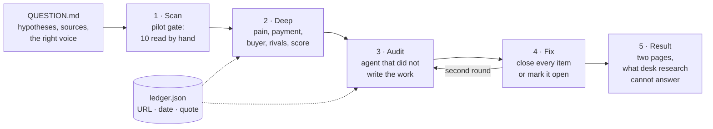

# kanitli-arastirma

[](https://github.com/kerem-aydin/kanitli-arastirma/actions/workflows/test.yml) 

*Kanıtlı araştırma* means *research with evidence*.

Ask a language model "what problem should I build for?" and you get a
confident, well-written answer that is often wrong: a market size from nowhere,
a quote nobody said, a "pain point" from three blog posts. This is the method I
use instead. Coding agents do the reading; the method decides what counts.



- **Five stages, each a separate agent run** with a fresh context: scan, deep
  verification, adversarial audit, fix, result. Files in, files out.
- **The auditor did not write the work.** It is told to act as an operator and
  an investor with no reason to be kind, re-verifies at least ten sources itself,
  and names every wrong, stale or templated claim. Audit and fix run **twice**.
- **Proof that people pay is defined in code**, not left to the model's taste
  (`src/rules.js`). A complaint count is never payment evidence.
- **Precision before volume.** Every new query passes a pilot gate: ten records
  read by hand, at least half relevant *and* from the person who pays.
- **Every claim lives in a ledger** with URL, date and a verbatim quote.
- **The result says what desk research cannot answer**, and designs the field
  test that would.

## What it taught me

These are numbers from my own research lines, October 2026.

**Volume did not answer the question.** One line pulled 161,000 raw rows from
public sources. 30,679 looked relevant. When the samples were read, about 81%
were the wrong voice (customers complaining, not the businesses that would
pay). The verdict was still *"no proof anyone pays."* After that, the pilot gate
and the payment classes became rules, and the next lines report precision
instead of row counts.

**An honest "nothing strong here" is a result.** Another line read 141,775 raw
rows and its best problem scored 31/100 with no payment evidence. That saved
weeks of building the wrong thing.

**Agents run out, so the pipeline resumes.** Each stage is skipped if its
output exists, usage limits are detected from the CLI's real message, and a
line can stop at any point and continue the next day. To keep background agents
from eating a human's usage, see
[ajan-ofisi](https://github.com/kerem-aydin/ajan-ofisi)'s usage guard.

## Use it

```bash
mkdir -p lines/my-question
cp examples/QUESTION.md lines/my-question/QUESTION.md   # write your own question
bash run.sh lines/my-question
```

Needs the [Codex CLI](https://github.com/openai/codex) (`codex exec`). Each
stage has its own time limit; the scan has the longest.

```
lines/my-question/
  QUESTION.md          the question, hypotheses, sources, the right voice
  pilot-decisions.json which queries passed the gate, with numbers
  raw/                 collected public records, personal data removed
  S1-scan.md           source yield table and problem clusters
  S2-deep.md, deep.json, ledger.json
  audit-1.md, fix-1.md, audit-2.md, fix-2.md
  RESULT.md            two pages for the person who decides
```

## Layout

```
method/stages.md   what each stage does, word for word what the agent reads
method/rules.md    precision, payment evidence, score, ledger, data, money, honesty
src/rules.js       the rules that code can check (tested)
run.sh             resumable runner, one headless agent run per stage
```

MIT · [Kerem Aydın](https://github.com/kerem-aydin)
